# Canvas Playground

A play track for learning game development with **vanilla JavaScript and the HTML5 canvas**. No frameworks, no libraries, no engine.

The rules: small dares, each with a goal and a hint or two. I reason through the code myself, test the weird cases on purpose, and write down what clicked. One folder per dare, copied forward from the last one, so every step stays runnable.

Ten dares in, a red square sliding across the screen has become a platformer character with inertia, gravity, collisions, and forgiving controls.

```
canvas-playground/
├── README.md        ← you are here
└── dares/
    ├── 01-glide/    index.html + main.js
    ├── 02-wheel/
    ├── ...
    └── 10-feel/
```

---

## Play it

### In the browser

Every dare is playable online through GitHub Pages. Click a dare, click the canvas once if the keys don't respond, and play:

| Dare       | Play                                                                      | Controls                                       |
| ---------- | ------------------------------------------------------------------------- | ---------------------------------------------- |
| 01 glide   | [▶ play](https://dani-sink.github.io/canvas-playground/dares/01-glide/)   | none, just watch                               |
| 02 wheel   | [▶ play](https://dani-sink.github.io/canvas-playground/dares/02-wheel/)   | ← ↑ → ↓ move                                   |
| 03 fair    | [▶ play](https://dani-sink.github.io/canvas-playground/dares/03-fair/)    | ← ↑ → ↓ move (fair diagonals)                  |
| 04 steady  | [▶ play](https://dani-sink.github.io/canvas-playground/dares/04-steady/)  | ← ↑ → ↓ move (same speed on any screen)        |
| 05 weight  | [▶ play](https://dani-sink.github.io/canvas-playground/dares/05-weight/)  | ← ↑ → ↓ push, release to slide                 |
| 06 walls   | [▶ play](https://dani-sink.github.io/canvas-playground/dares/06-walls/)   | ← ↑ → ↓ push, bounce off walls                 |
| 07 block   | [▶ play](https://dani-sink.github.io/canvas-playground/dares/07-block/)   | ← ↑ → ↓ push, bump the box                     |
| 08 room    | [▶ play](https://dani-sink.github.io/canvas-playground/dares/08-room/)    | ← ↑ → ↓ push around the room                   |
| 09 gravity | [▶ play](https://dani-sink.github.io/canvas-playground/dares/09-gravity/) | ← → run · ↑ jump                               |
| 10 feel    | [▶ play](https://dani-sink.github.io/canvas-playground/dares/10-feel/)    | ← → run · ↑ jump (tap = hop, hold = full jump) |

Things to try in **10 feel**: run off the Platform and jump a split second late (coyote time), press jump just before landing (jump buffer), and compare a tap with a hold (variable jump height).

### Locally

1. Clone the repo:
   ```
   git clone https://github.com/dani-sink/canvas-playground.git
   cd canvas-playground
   ```
2. Serve the folder with any static server. ES modules don't load over `file://`, so double-clicking `index.html` won't work:
   ```
   npx serve .
   # or
   python3 -m http.server
   ```
   (VS Code's Live Server extension works too.)
3. Open a dare in the browser, e.g. `http://localhost:3000/dares/10-feel/` (or port `8000` with Python).

---

## The journey at a glance

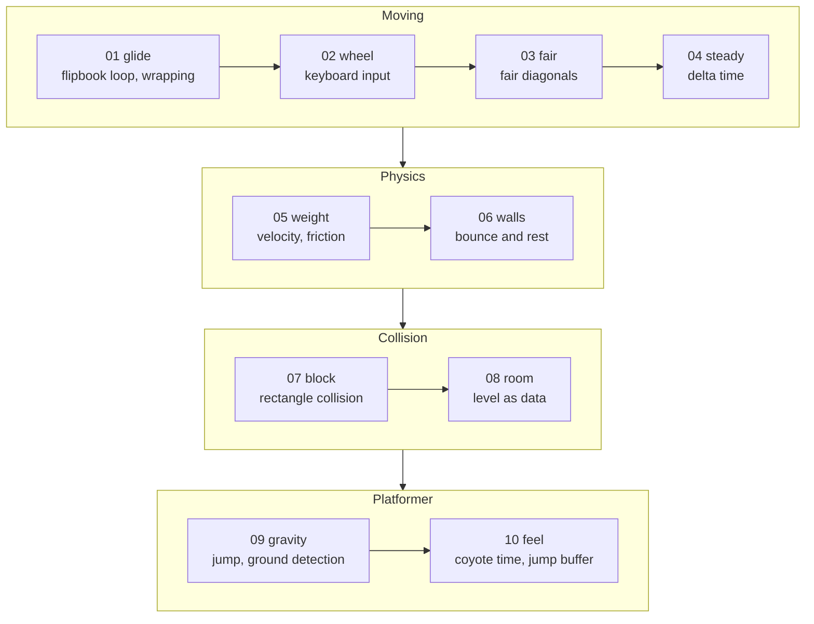

| #   | Dare    | What it added                           | The idea that clicked                                   |
| --- | ------- | --------------------------------------- | ------------------------------------------------------- |
| 01  | glide   | A square loops across the screen        | Animation is a flipbook: clear, update, draw, repeat    |
| 02  | wheel   | Arrow keys drive the square             | Listeners record, the loop decides. One source of truth |
| 03  | fair    | Same speed in all 8 directions          | Normalize: direction (length 1) × speed                 |
| 04  | steady  | Same speed on any screen                | Move by `speed × dt`, and cap `dt`                      |
| 05  | weight  | Speeds up, slides to a stop             | Acceleration → velocity → position, each × `dt`         |
| 06  | walls   | Solid walls that bounce                 | A hit fixes _where_ AND _how it moves_. Rest vs. bounce |
| 07  | block   | A box in the middle of the room         | Overlap on X **and** Y. Move one axis at a time         |
| 08  | room    | Many boxes, one loop                    | The level is data, not code                             |
| 09  | gravity | Side view, jumping, landing             | Derive physics from feel values. Grounded = pushed up   |
| 10  | feel    | Coyote time, jump buffer, variable jump | Correct physics ≠ good feel. Timers in game time        |

---

## The engine today

Every frame runs the same four steps in the same order. Each step finishes before the next one reads its result.

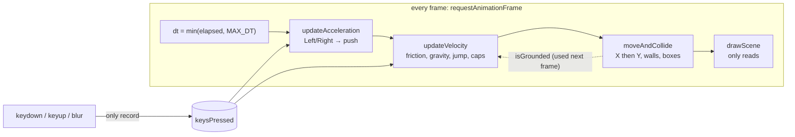

State comes in two kinds, and keeping them apart solved more bugs than anything else:

| Remembered between frames          | Recomputed every frame   |
| ---------------------------------- | ------------------------ |
| `x`, `y`, `velocityX`, `velocityY` | `accelX` (from the keys) |
| `isGrounded`, `wasUpHeld`          | `dt`                     |
| `coyoteTimer`, `jumpBufferTimer`   | hit list, square bounds  |

---

## Dare by dare

### 01 – glide

📓 [Full notes](dares/01-glide/) · ▶ [Play](https://dani-sink.github.io/canvas-playground/dares/01-glide/)

**Goal:** a square glides left to right and wraps forever.

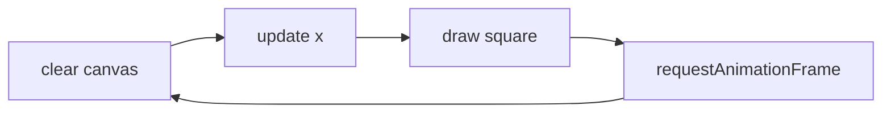

```
  -30      0                                   400
   |▓▓|----|----------- canvas ---------------|▓▓|
   ↑ just hidden on the left                  ↑ just hidden on the right
   one lap = 400 + 30 = 430 px
```

- `x++ % width` _looked_ right, but `x` grew forever. State should tell the truth.
- Wrap from `-size`, so the square slides in instead of popping in.
- `x === 400` misses when the step skips past 400. Use `>=`.
- Carry the overshoot: `x = -size + (x - width)`. Resetting forgets how far past the edge you went; subtracting a lap remembers.

### 02 – wheel

📓 [Full notes](dares/02-wheel/) · ▶ [Play](https://dani-sink.github.io/canvas-playground/dares/02-wheel/)

**Goal:** arrow keys move the square smoothly, diagonals work, wraps on all four edges.

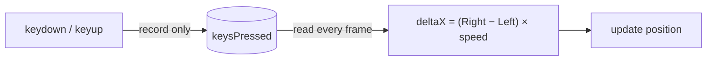

| Left | Right | Right − Left | Movement   |
| ---- | ----- | ------------ | ---------- |
| ✗    | ✗     | 0            | none       |
| ✗    | ✓     | 1            | right      |
| ✓    | ✗     | −1           | left       |
| ✓    | ✓     | 0            | cancel out |

- Moving inside `keydown` stutters (OS key-repeat). Listeners record, the loop decides.
- A `moving` flag drifted out of sync with the keys → **one source of truth**, recomputed every frame.
- A teleporting square turned out to be ping-pong between two wrap checks. Found it by logging `x` for two frames.
- In an if/else chain, line order silently decided opposite keys. `+=` makes them cancel; booleans are 0/1 in math.

### 03 – fair

📓 [Full notes](dares/03-fair/) · ▶ [Play](https://dani-sink.github.io/canvas-playground/dares/03-fair/)

**Goal:** diagonals no faster than straight moves.

```
        ↑ (0, −1)    ↗ (1, −1)  length √2 ≈ 1.41   ← 41% faster
        |          /
        |        /
        o──────→ (1, 0)  length 1

normalize: divide by length → (0.707, −0.707), length 1
```

- Arrow length = `√(x² + y²)`. Divide by it to get length 1, then multiply by speed.
- No keys → length 0 → `0 / 0 = NaN`, and once NaN gets into `x` the square is gone. Guard it.
- `0.24999999999999997` is float rounding, not a bug. Don't compare computed floats with `===`.

### 04 – steady

📓 [Full notes](dares/04-steady/) · ▶ [Play](https://dani-sink.github.io/canvas-playground/dares/04-steady/)

**Goal:** speed in pixels per **second**, the same on every screen.

```
240 Hz:  |·|·|·|·|·|·|·|·|·|·|·|·|   ~0.004 s per frame → 0.4 px per frame
 60 Hz:  |···|···|···|···|···|···|   ~0.017 s per frame → 1.7 px per frame
both:    100 px/s × elapsed seconds = 100 px per second ✓
```

- My 240Hz screen hid the bug: `speed = 0.25` px/frame "felt right," but would crawl 4× slower at 60Hz.
- `dt` = this timestamp − last timestamp. Units decide the formula: (px/s) × s = px.
- Hidden tabs pause the loop. Coming back, one frame claimed **4.35 s** → a 435 px teleport (almost exactly one lap, so it _looked_ fine). Cap: `Math.min(dt, MAX_DT)`.
- Missed `keyup` while on another tab → stuck key. On `blur`, assume nothing is held, because that wrong guess fixes itself.

### 05 – weight

📓 [Full notes](dares/05-weight/) · ▶ [Play](https://dani-sink.github.io/canvas-playground/dares/05-weight/)

**Goal:** speeds up when pressing, slides to a stop when releasing.

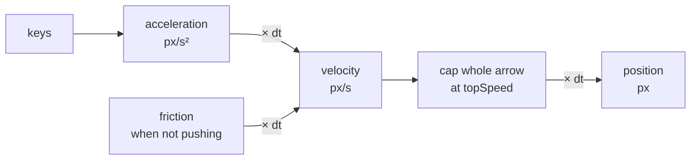

- Velocity is **remembered** (physical state), unlike input (read fresh). Nothing outside the game knows it.
- Capping each axis separately let diagonals reach 150 × √2 ≈ 212. Cap the **whole arrow**.
- The cap ran _after_ moving, and the log printed _after_ the cap, so it always showed a perfect 150. Finish computing velocity before anything uses it.
- Friction must never cross zero (jitter). One `Math.sign` path for both directions removed a mirrored-copy bug.

### 06 – walls

📓 [Full notes](dares/06-walls/) · ▶ [Play](https://dani-sink.github.io/canvas-playground/dares/06-walls/)

**Goal:** the edges become solid walls; the square bounces and loses energy.

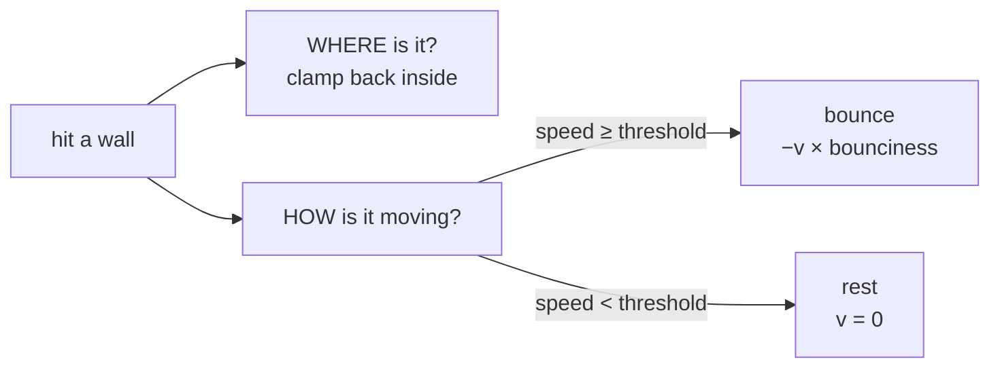

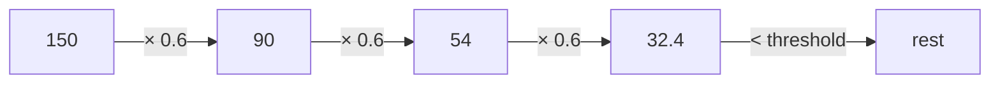

- Leaning on a wall = 240 invisible bounces per second. Invisible on screen, but the game _thinks_ it's bouncing.
- The rest threshold must beat the most speed one frame of pushing can add: `acceleration × MAX_DT`. **Derived**, not guessed.
- Predicted 3 bounces with math, then counted 3 in the game.

### 07 – block

📓 [Full notes](dares/07-block/) · ▶ [Play](https://dani-sink.github.io/canvas-playground/dares/07-block/)

**Goal:** a solid box in the middle of the room, on all four sides.

```
square    [120 ──────── 150)
obstacle               [150 ──────── 250)
          edges touch at 150 → NOT overlapping (half-open intervals)

overlap on one axis:  (b1 < a2) && (a1 < b2)   "each starts before the other ends"
rectangles collide:   overlap on X  AND  overlap on Y
```

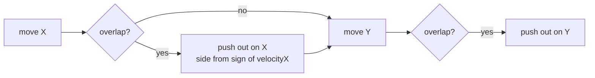

- Derived the overlap test with De Morgan, then proved the touching case by plugging in 150 vs 150.
- After only `x` changed, any overlap must have come from X, so the sign of the velocity tells the side.
- `x` is the **left** edge: arriving from the left means `x = obstacleX − squareSide`.
- Exact corners always resolve on Y, because Y moves second.
- Same return shape from every branch (`{ pos, vel }`), or `.pos` becomes `undefined` → NaN.

### 08 – room

📓 [Full notes](dares/08-room/) · ▶ [Play](https://dani-sink.github.io/canvas-playground/dares/08-room/)

**Goal:** many obstacles, and code that doesn't care how many.

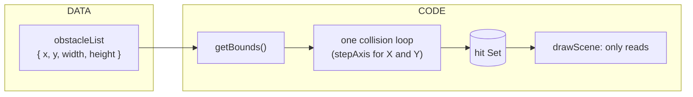

- Store one form, derive the other. One `getBounds` for the square and every box.
- Rebuild the square's bounds for _every_ box, so box B sees the push-out from box A.
- Moving code into a function changed which variables it could see (stale globals).
- A 30 px gap fits a 30 px square on paper, but not in practice: `x` would have to be exactly 260.000.
- Tests disproved one of my predictions. Tests decide.

### 09 – gravity

📓 [Full notes](dares/09-gravity/) · ▶ [Play](https://dani-sink.github.io/canvas-playground/dares/09-gravity/)

**Goal:** side view. Gravity, floors, and a jump.

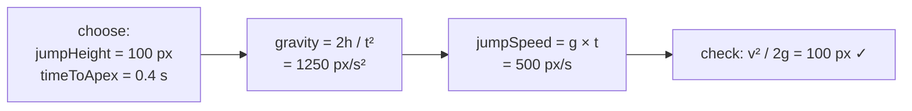

```
 before   ┌──┐  square (30 px)      y ≤ 190
          └──┘
 ━━━━━━━━━━━━━━━━━━━━━━  platform top 220
 ▓▓▓▓▓▓▓▓▓▓▓▓▓▓▓▓▓▓▓▓▓▓  20 px thick
 ━━━━━━━━━━━━━━━━━━━━━━  platform bottom 240
 after    ┌──┐                       y ≥ 240
          └──┘
 tunneling needs a single step > 20 + 30 = 50 px
 max step = terminalVelocity × MAX_DT = 600 × 1/30 = 20 px ✓
```

- Old assumptions broke: the whole-arrow cap would kill the jump (now horizontal only), normalization became pointless, one rest threshold wasn't enough (now per axis).
- **Grounded** = the Y pass pushed the square _up_ out of something. Ceiling bonks and side hits don't count.
- A log of `true`/`false` frames turned out to be measurements: airtime → bounce speeds → 6 hops. Then: walls bounce, floors don't (per-axis bounciness).
- "No parameter" silently meant "don't touch velocity" → the square "stood" while falling at 600 px/s. Pass values explicitly.
- Jump on **just pressed** (an event), not **held** (a state), or it's a pogo stick.

### 10 – feel

📓 [Full notes](dares/10-feel/) · ▶ [Play](https://dani-sink.github.io/canvas-playground/dares/10-feel/)

**Goal:** close the gap between what the player meant and what the game did.

```
COYOTE TIME                                 JUMP BUFFER
 on ground ██████████|                       press Up ▼
                     |←── 0.1 s ──→|                  |←── 0.1 s ──→|
 can jump  ████████████████████████|         on ground             ████████
                     ▲ ran off the ledge     jump fires            ▲ landed in time
```

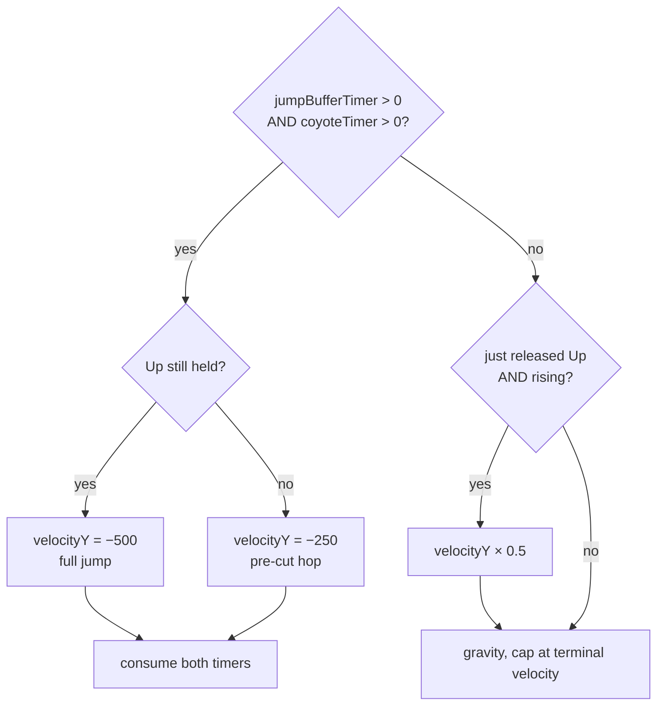

- **Air control:** gentler acceleration and much less friction in the air.
- **Coyote time:** jump for 0.1 s after leaving a ledge. An extra `isGrounded` check had blocked the exact case it exists for.
- **Jump buffer:** a press 0.1 s before landing still counts. It started at 0.1 = a fake press at boot. Timers start at 0.
- **Variable height:** tap ≈ 29.6 px, hold ≈ 101 px. A buffered tap released in the air used to give a full jump; now the launch checks the held _state_.
- Timers count `dt` (game time), so a tab switch froze the square **and** the windows.

---

## Ideas that kept coming back

| Idea                                | Where it showed up                                                                  |
| ----------------------------------- | ----------------------------------------------------------------------------------- |
| **One source of truth**             | `moving` flag (02) · stored obstacle form (08) · `isGrounded` returned twice (09)   |
| **Remembered vs. recomputed**       | input vs. velocity (05) · `isGrounded`, timers (09–10)                              |
| **Units guide the formula**         | px/s × s (04) · px/s² × s (05) · `g = 2h / t²` (09)                                 |
| **Derive, don't guess**             | `restThreshold` (06) · gravity & jump speed (09) · tunneling limit (09)             |
| **Trace numbers**                   | ping-pong wrap (02) · 4.35 s frame (04) · 6-hop log (09) · 29.6 px tap (10)         |
| **Mirrored code hides bugs**        | wraps (02) · `max` vs `min` (05) · X/Y loops (08)                                   |
| **Order matters**                   | cap before move (05) · X then Y, corner bias (07) · grounded from last frame (09)   |
| **State vs. event**                 | held vs. just pressed (09) · release before launch (10)                             |
| **Invisible ≠ correct**             | 240Hz hid frame-rate bugs (04) · micro-bounces (06) · falling while "standing" (09) |
| **Test the weird cases on purpose** | tab switch (04) · seam & corridor (08) · buffered tap (10)                          |

---

## Tuning cheat sheet (as of 10)

| Value                                    | Number    | Unit  | Notes                       |
| ---------------------------------------- | --------- | ----- | --------------------------- |
| `jumpHeight`                             | 100       | px    | feel value                  |
| `timeToApex`                             | 0.4       | s     | feel value                  |
| `gravity`                                | 1250      | px/s² | derived: `2h / t²`          |
| `jumpSpeed`                              | 500       | px/s  | derived: `g × t`            |
| `terminalVelocity`                       | 600       | px/s  | max fall speed              |
| `topSpeed`                               | 150       | px/s  | horizontal only             |
| `groundAcceleration` / `airAcceleration` | 400 / 260 | px/s² |                             |
| `groundFriction` / `airFriction`         | 300 / 60  | px/s² |                             |
| `bouncinessX` / `bouncinessY`            | 0.6 / 0   | —     | springy walls, solid floors |
| `coyoteTime` / `jumpBufferTime`          | 0.1 / 0.1 | s     | game time                   |
| `jumpCutMultiplier`                      | 0.5       | —     | tap ≈ 25–30 px              |
| `MAX_DT`                                 | 1/30      | s     | frame cap + tunneling guard |

---

## Still on the list

- **Sub-steps** so tunneling is impossible at any speed
- **Fixed timestep** so jump height doesn't shift with frame rate
- **Input intents:** the input step produces `accelX`, `jumpPressed`, `jumpHeld`; physics just applies them
- Corner correction for near-exact gaps · hit vs. rest events · braking on turnaround
- **Next up:** a world bigger than the screen, with a camera that follows the square
